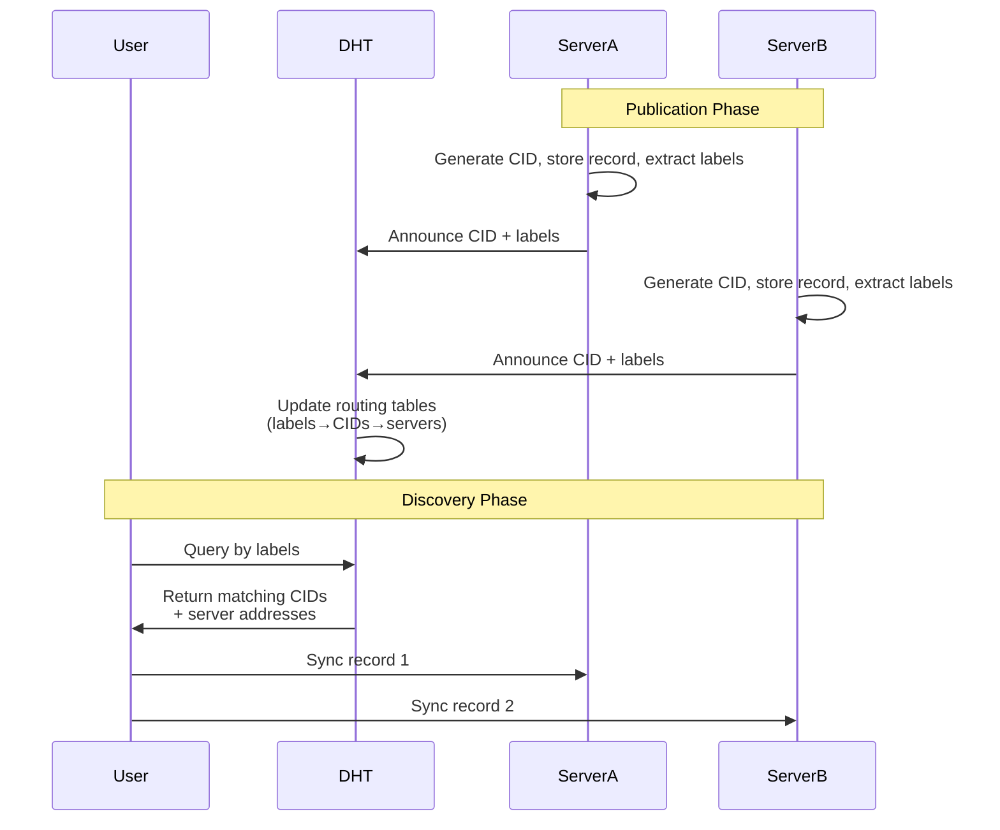

# Routing

**Routing** (content routing) is a core Directory component that maps agent **skills** to
record identifiers and to the directory servers that host those records. It builds on a
[Distributed Hash Table (DHT)](https://en.wikipedia.org/wiki/Distributed_hash_table) so
discovery scales across a decentralized network of peers.

## Announce and discover

Publishing a record to the network is a two-step process:

1. **Store** — push the record to local storage and obtain its CID.
2. **Announce** — call `routing publish` so the server advertises the CID and its skill
   taxonomy in the DHT. Announcements are processed asynchronously and have a TTL; republish
   periodically to keep routing data fresh.

Discovery uses:

- **`routing list`** — records indexed on the local peer only.
- **`routing search`** — records announced by remote peers (cached network view).

Skill matching supports exact and hierarchical prefix matching. Network search results
reflect cached announcements and may be stale or incomplete until peers replicate records.

ADS uses [libp2p Kad-DHT](https://github.com/libp2p/specs/tree/master/kad-dht) for server and
content discovery.

## Publication and discovery flow



## Republishing of records

The node announces all records in its local store to the network again at regular intervals, to show that the records are still available.

Up to and including v1.9.1, the `routing.republish_interval` key set this interval. The Directory server then announced its local records again through both GossipSub and the DHT. This key is now split into two keys, one for each announcement path:

| Key | Default | What it controls |
|---|---|---|
| `routing.dht_reprovide_interval` | 22h | How often the node announces its provider records to the DHT again. Remote peers delete a provider record after `routing.record_ttl`. |
| `routing.gossipsub.reprovide_interval` | 22h | How often the node sends its local records over GossipSub again. Each round sends every local record to every subscriber. |

A node that still sets `routing.republish_interval` does not start. The key in the configuration file and the `*_ROUTING_REPUBLISH_INTERVAL` environment variable both cause this error. The error message gives the names of the two new keys. If the node ignored the old key, it would use the 22h default and the operator would not know.

In `daemon.config.yaml`, the routing keys are under `server.routing`. This configuration:

```yaml
routing:
  republish_interval: 36h
```

becomes:

```yaml
routing:
  dht_reprovide_interval: 36h
  gossipsub:
    reprovide_interval: 36h
```

To use the 22h defaults, remove the old key and do not set the new keys.

The node also does a check of these values at startup. If a check fails, the node does not start:

- `routing.dht_reprovide_interval` must be lower than `routing.record_ttl`. If it is not lower, provider records expire on remote peers before the node announces them again.
- `routing.max_label_age` must be greater than `routing.dht_reprovide_interval`.
- If GossipSub is enabled, `routing.max_label_age` must also be greater than `routing.gossipsub.reprovide_interval`.

The last two checks make sure that the node does not delete a remote label as stale before the next announcement refreshes it. `routing.record_ttl` and `routing.max_label_age` both default to 48h.

## Synchronization

Discovery identifies *where* records live; **synchronization (sync)** replicates them
locally. After `routing search` surfaces records hosted on a remote peer, those records can
be synced into the local node for offline access, backup, and cross-network collaboration.
Sync is one-way: content flows from a remote Directory instance to the local node.

### How sync works

Directory uses [regsync](https://github.com/regclient/regclient/tree/main/cmd/regsync)
(from regclient) as the synchronization engine for all registry types. When a sync operation
is created, the reconciler generates a regsync configuration and runs `regsync once` to pull
content from remote registries. Objects are stored as OCI artifacts (manifests, blobs, and
tags), enabling container-native synchronization with secure credential exchange between
Directory nodes.

Sync operations are managed asynchronously by a reconciler. Creating, listing, checking the
status of, and deleting a sync are all recorded as desired state that the reconciler
processes in the background.

### Sync driven by search

Because sync pairs naturally with discovery, routing search results can drive selective
replication: feeding `routing search` output into a sync operation creates separate sync
operations for each remote peer found, syncing only the CIDs that matched the search.

## Related documentation

- [Architecture](dir-architecture.md) — full system design and diagram
- [Records](dir-component-records-validation.md) — skill taxonomy and record structure
- [Usage Guide — Announce / Discover](dir-features-scenarios.md#announce) — CLI walkthroughs
- [Usage Guide — Sync](dir-features-scenarios.md#sync) — sync CLI walkthroughs
- [CLI Reference — Routing Operations](dir-cli-reference.md#routing-operations) — `routing publish`, `unpublish`, `list`, `search`, `info`
- [CLI Reference — Synchronization](dir-cli-reference.md#synchronization) — `sync create`, `list`, `status`, `delete`
- [Import](dir-component-import.md) — bringing records in from external (non-Directory) registries
- [Federation](dir-federation-overview.md) — multi-instance routing across federated directories
